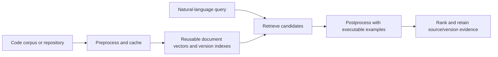

# CodeDoctor · VITV / Doctors

**Samsung PRISM GenAI Hackathon · Theme 01: Agentic Code Intelligence**

CodeDoctor retrieves ranked source code. Our contribution is a **pre/post-processing
architecture around an existing embedding model**: prepare reusable, version-aware
representations before retrieval, then check candidate behavior against the query’s
worked examples after retrieval. We do not train a new embedding model or generate
answers in place of code.

## Our pre/post-processing architecture

| Stage | Scored AppsRetrieval path | Repository and version workbench |
| --- | --- | --- |
| Preprocess | Exact MTEB corpus text, pinned encoder recipe, offline content-addressed document embeddings | Tree-sitter chunks with file/line spans, symbol and call/import indexes, recipe-keyed embeddings reused across edits and renames |
| Retrieve | F2LLM-v2 cosine similarity | Exact-symbol, BM25, structural and dense retrieval with routing and rank fusion |
| Postprocess | Parse worked examples, verify candidate Python with stdin or call-style inputs, deepen verification when needed | Shared execution checks, verify competing variants before grouping by lineage, deduplicate unchanged content and retain version provenance |
| Return | Official MTEB ranked predictions and result JSON | Ranked source spans with retrieval evidence, execution outcomes and version identity |

The architectural distinction is **behavioral evidence after semantic retrieval**,
combined with **reusable representations before retrieval**. Example execution can
distinguish near-identical programs that compute different answers. Content-addressed
embeddings avoid re-encoding unchanged functions when a repository changes. Version
verification occurs before grouping, so a plausible but incorrect variant does not
win merely because it was selected as the lineage representative.

These are our implementation contributions, not a claim that every component is new
to research. BM25, embeddings, tree-sitter and rank fusion are established techniques.
The workbench router and structural features do **not** produce the P0 MTEB score.



## Configuration and operating points

`config/submission.yaml` is the final recipe: **F2LLM-v2-1.7B, CPU FP32 query
inference**, pinned revision, published instruction prefix, EOS, last-token pooling,
normalized vectors and 8,192-token cap. It enables accepted call-style verification,
blank-line fallback, judge-like I/O, interactive-statement skipping, adaptive
verification depth and CPU-time limits. No OpenVINO or llama.cpp treatment ships.

The optional **0.6B interactive tier** is a separate operating point. Its latency and
quality must never be combined with the 1.7B results. The default for the evaluator
and workbench is 1.7B. The original `config/frozen.yaml` remains unchanged.

## Clean-clone setup and demo

Use Python 3.11 or 3.12 and Git. Allow sufficient disk space for model weights and
several GB of free RAM for the 1.7B model. First use downloads the pinned model.

```sh
git clone https://github.com/krizz711/CodeDoctor-Agentic-Semantic-and-Structural-Intelligence-for-Code-Repositories.git
cd CodeDoctor-Agentic-Semantic-and-Structural-Intelligence-for-Code-Repositories
python -m venv .venv
source .venv/bin/activate
# Linux CPU; on macOS use: pip install torch==2.8.0
pip install torch==2.8.0 --index-url https://download.pytorch.org/whl/cpu
pip install -r requirements-submission.txt
python -m uvicorn app.server:app --host 127.0.0.1 --port 8077
```

Open `http://127.0.0.1:8077`, choose a local repository, build its index, and search
or compare versions. On Windows activate with `.venv\Scripts\Activate.ps1`.
For the explicit smaller mode, set `CODEDOCTOR_TIER=interactive` before starting
the server. It is not the scored accuracy configuration.

## Reproduce the submission

The [recorded commands](scripts/README.md) cover Kaggle and direct execution.
The [reporting protocol](docs/submission/PROTOCOL.md) specifies the frozen behavior,
checks, dataset exposure and time limits. The hosted builder packages exact Git
blobs and records the source commit, checksums, hardware, packages and raw logs.

1. Build the complete offline document cache. GPU preprocessing is allowed by the FAQ.
2. Run the 40-function rebuild fixture three times and the 12-lineage version fixture
   on CPU with the 1.7B tier.
3. Encode four disjoint CPU query shards, preserving checkpoints and provenance.
4. Merge verified shards, re-encode 30 seeded queries live and score once with the
   official MTEB AppsRetrieval evaluator using `cache=None`.
5. Validate the JSON and verify measured source against the release commit.

The staged query stores are an authorized execution checkpoint. No test labels
choose the model, configuration or shards. **Final scoring replay time is not live
retrieval latency**; report CPU encoding and scoring stages separately. A judge can
run the same evaluator without saved query vectors. `running.ipynb` is a generated
companion notebook, not a separate implementation.

## Results and evidence status

Final CPU measurements are being collected; no new final score is claimed yet.
The root `appsretrieval_results.json` is **historical**: NDCG@10 0.96558 and MRR@10
0.95857 with the original frozen configuration and GPU query encoding. It does not
measure the current CPU submission. New results belong under `results/final/`.

P1 and Bonus fixtures exercise the real workbench. Bonus intentionally includes
incorrect variants that fail the supplied examples; its outcome is a synthetic
functional check, not unseen-repository accuracy. Rebuild timings are specific
to the measured machine and fixture.

Research outcomes, including null and negative findings, remain in the
[experiment register](experiments/REGISTER.md). Original runnable research is
preserved by tag `research-archive-2026-09-30`; archived files and path mappings
are under [archive](archive/README.md). C3 OpenVINO runs were void. C4 Q8 was
stopped incomplete and was not adopted.

## Disclosures and limitations

- The model’s documented training sources make APPS/CodeContests exposure plausible;
  per-problem exposure is unverified. See the preserved
  [training-data disclosure](docs/history/README-before-final-submission.md#disclosures-added-after-the-samsung-faq).
- Earlier execution-depth and numeric-comparison choices used the APPS test split.
  The historical audit is retained. The current final run reports a frozen choice;
  it cannot establish wholly unseen generalization.
- Example parsing can fail, fragments may not execute independently, and passing
  visible examples does not prove program correctness. Queries without runnable
  examples retain retrieval-based ordering.
- Candidate code runs in a resource-limited subprocess. This is **not filesystem or
  network isolation**. Run benchmark code in a disposable environment.
- CPU query encoding can be expensive. We make no unmeasured speedup claim and
  impose no invented jury latency threshold.
- The FAQ prefers CPU retrieval and permits GPU preprocessing, including updates.
  It does not require an absolute CPU-only workflow. Full verbatim FAQ: `CLAUDE.md`.

## Development checks

```sh
pip install ruff
python -m pytest -q -rs -m "not model and not data"
python -m ruff check app scripts tests --select F401,F811
python -m compileall -q app scripts tests
make -B
make -B test
python scripts/evaluate.py scripts/sample_eval.jsonl --output build/sample_results.json
python scripts/validate_submission.py build/sample_results.json
```

Model/data tests require their artifacts and are reported separately. Format checks
alone do not reproduce scores. See [project instructions](AGENTS.md) for evidence
rules. Model and bundled dependency licenses remain those of their upstream authors;
the repository does not currently include a top-level license grant.

## Submission materials and checklist

| Checklist Item | Location / Reference | Notes |
| --- | --- | --- |
| **Working Prototype Code** | GitHub repository root (`main` branch) | Reproducible setup via virtualenv or Docker |
| **Requirements** | [`requirement.txt`](requirement.txt) / [`requirements.txt`](requirements.txt) | Pinned dependency specifications |
| **Presentation Deck** | [`VITV_Doctors_Submission.pptx`](VITV_Doctors_Submission.pptx) | Editable 12-slide template submission |
| **Presentation PDF** | [`VITV_Doctors_Submission.pdf`](VITV_Doctors_Submission.pdf) | Matching high-resolution PDF export |
| **Demo Video** | [Walkthrough Video (YouTube)](https://youtu.be/0k2UUJOp-Tc) | 5-minute walkthrough of indexing, retrieval, and versioning |
| **AI Disclosure** | [`LangAI3.0_AI_Disclosure.docx`](LangAI3.0_AI_Disclosure.docx) | Completed AI tools disclosure form |
| **Release Tag** | `PRISM_GENAI_HACKATHON_Y2026` | Official judge-facing release tag on final commit |

### Demo Video Walkthrough
- **Recording Link:** [CodeDoctor Demo Walkthrough (YouTube)](https://youtu.be/0k2UUJOp-Tc)
- **Duration:** Under 5 minutes
- **Content:** Demonstrates repository onboarding, tree-sitter chunking, semantic natural language search with source span citations, fast incremental re-indexing with vector reuse, and cross-version behavioral ranking using executable worked examples.

### Team Information
- **College:** VITV (Vellore Institute of Technology, Vellore)
- **Team Name:** Doctors
- **Theme:** Theme 01: Agentic Code Intelligence
