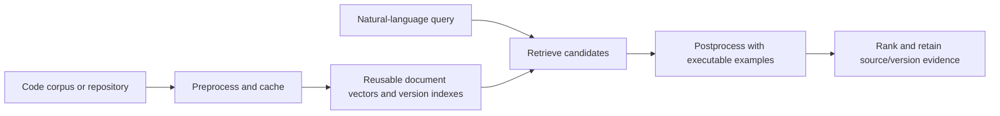

# CodeDoctor · VITV / Doctors

**Samsung PRISM GenAI Hackathon · Theme 01: Agentic Code Intelligence**

CodeDoctor retrieves ranked source code. Our contribution is a **pre/post-processing
architecture around an existing embedding model**: prepare reusable, version-aware
representations before retrieval, then check candidate behavior against the query’s
worked examples after retrieval. We do not train a new embedding model or generate
answers in place of code.

## Our pre/post-processing architecture

| Stage | Scored AppsRetrieval path | Repository and version workbench |
| --- | --- | --- |
| Preprocess | Exact MTEB corpus text, pinned encoder recipe, offline content-addressed document embeddings | Tree-sitter chunks with file/line spans, symbol and call/import indexes, recipe-keyed embeddings reused across edits and renames |
| Retrieve | F2LLM-v2 cosine similarity | Exact-symbol, BM25, structural and dense retrieval with routing and rank fusion |
| Postprocess | Parse worked examples, verify candidate Python with stdin or call-style inputs, deepen verification when needed | Shared execution checks, verify competing variants before grouping by lineage, deduplicate unchanged content and retain version provenance |
| Return | Official MTEB ranked predictions and result JSON | Ranked source spans with retrieval evidence, execution outcomes and version identity |

The architectural distinction is **behavioral evidence after semantic retrieval**,
combined with **reusable representations before retrieval**. Example execution can
distinguish near-identical programs that compute different answers. Content-addressed
embeddings avoid re-encoding unchanged functions when a repository changes. Version
verification occurs before grouping, so a plausible but incorrect variant does not
win merely because it was selected as the lineage representative.

These are our implementation contributions, not a claim that every component is new
to research. BM25, embeddings, tree-sitter and rank fusion are established techniques.
The workbench router and structural features do **not** produce the P0 MTEB score.



## Configuration and operating points

`config/submission.yaml` is the current submission recipe: **F2LLM-v2-1.7B, CPU FP32 query
inference**, pinned revision, published instruction prefix, EOS, last-token pooling,
normalized vectors and 8,192-token cap. It enables accepted call-style verification,
blank-line fallback, judge-like I/O, interactive-statement skipping, adaptive
verification depth and CPU-time limits. No OpenVINO or llama.cpp treatment ships.

The optional **0.6B interactive tier** is a separate operating point. Its latency and
quality must never be combined with the 1.7B results. The default for the evaluator
and workbench is 1.7B. The original `config/frozen.yaml` remains unchanged.

## Clean-clone setup and demo

Use Python 3.11 or 3.12 and Git. Allow disk space for model weights; first use
downloads the pinned model. The recorded hosted hands-on process peaked at about
10.4 GB of process-tree RSS, with a fixture RSS maximum of 10.85 GB, on a host
with 31.35 GiB RAM. The local 8 GiB Mac cannot accommodate that recorded peak.
These are measured fixture costs, not universal memory limits.

```sh
git clone https://github.com/krizz711/CodeDoctor-Agentic-Semantic-and-Structural-Intelligence-for-Code-Repositories.git
cd CodeDoctor-Agentic-Semantic-and-Structural-Intelligence-for-Code-Repositories
python -m venv .venv
source .venv/bin/activate
# Linux CPU; on macOS use: pip install torch==2.8.0
pip install torch==2.8.0 --index-url https://download.pytorch.org/whl/cpu
pip install -r requirements-submission.txt
python -m uvicorn app.server:app --host 127.0.0.1 --port 8077
```

Open `http://127.0.0.1:8077`, choose a local repository, build its index, and search
its source spans. **Open a folder** creates one `working` snapshot, even when the
directory contains `.git`; the built-in `CodeDoctor · app/` target demonstrates
Git history, version comparison and cross-version retrieval. Opening an arbitrary
external Git repository does not currently import its commit history.
On Windows activate with `.venv\Scripts\Activate.ps1`.
For the explicit smaller mode, set `CODEDOCTOR_TIER=interactive` before starting
the server. It is not the scored accuracy configuration.

`requirements-submission.txt` pins the model/evaluator packages and portable
`torch==2.8.0`; `requirement.txt` is a compatibility alias. Base service dependencies
in `requirements.txt` retain supported minimum versions. Transitive versions and
platform-specific wheels are recorded in each run's `requirements-measured.txt`.
Those freezes are evidence, not portable installation inputs. No automatically
selected `requirements-lock.txt` is supplied.

The Dockerfile uses the same CPU recipe and fails if the C++ build or its checks
fail. The image excludes `.git`, model/cache files and local evidence. Mount an
external source directory to use **Open a folder**; built-in history demonstrations
need a normal Git checkout. A successful Docker build is not currently claimed.

## Reproduce the submission

The [recorded commands](scripts/README.md) cover Kaggle and direct execution.
The [reporting protocol](docs/submission/PROTOCOL.md) specifies the frozen behavior,
checks, dataset exposure and time limits. The hosted builder packages exact Git
blobs and records the source commit, checksums, hardware, packages and raw logs.

1. Build the complete offline document cache. GPU preprocessing is allowed by the FAQ.
2. Run the 40-function rebuild fixture three times and the 12-lineage version fixture
   on CPU with the 1.7B tier.
3. Encode four disjoint CPU query shards, preserving checkpoints and provenance.
4. Merge verified shards, re-encode 30 seeded queries live and score once with the
   official MTEB AppsRetrieval evaluator using `cache=None`.
5. Validate the JSON and verify measured source against the release commit.

The staged query stores checkpoint query vectors computed on CPU. They are separate
from MTEB result caching, which is disabled. No test labels choose the model,
configuration or shards. **Final scoring replay time is not live
retrieval latency**; report CPU encoding and scoring stages separately. A judge can
run the same evaluator without saved query vectors. `running.ipynb` is a generated
companion notebook, not a separate implementation.

## Results and evidence status

There is **no validated current P0 result for the CPU submission** yet. Final
reporting must include a complete MTEB result, ranked-response CSV, execution audit
and matching source/environment evidence before the current score is claimed.
The root `appsretrieval_results.json` is **historical**: NDCG@10 0.96558 and MRR@10
0.95857 with the original frozen configuration and GPU query encoding. It does not
measure the current CPU submission. New results belong under `results/final/`.

P1 and Bonus fixtures exercise the real workbench. Bonus intentionally includes
incorrect variants that fail the supplied examples; its outcome is a synthetic
functional check, not unseen-repository accuracy. Rebuild timings are specific
to the measured machine and fixture. The recorded hosted run used source commit
`823aa87dc0c6388f67c1637043c406cf743f1290`, Python 3.12.13, PyTorch 2.8.0+cpu,
and a 2.20 GHz Intel Xeon with 4 logical/2 physical CPUs. It predates the present
fixes and does not verify their benchmark results.

| P1 operation | Median seconds, 3 repetitions | Chunks encoded / reused |
| --- | ---: | ---: |
| Full build | 102.777 | 50 / 0 |
| Unchanged source | 1.512 | 0 / 50 |
| Edit one function | 6.452 | 2 / 48 |
| Edit ten functions | 29.507 | 13 / 37 |
| Add one function | 4.345 | 2 / 50 |
| Delete one function | 1.443 | 0 / 50 |
| Rename file | 1.423 | 0 / 50 |

The fixture contained 40 Python functions across 10 modules (50 chunks). In all
three repetitions, six probe queries matched a fresh rebuild's rankings and the
minimum compared vector cosine was 1.0. These are cache correctness and rebuild
measurements; they are not general repository retrieval accuracy. Raw evidence:
[P1 JSON](results/hands-on/hands-on/p1.json),
[environment](results/hands-on/environment.json) and
[run log](results/hands-on/run.log).

The **synthetic** Bonus fixture used 12 lineages across three snapshot versions:
12/12 correct variants first with execution verification, versus 1/12 without
verification; median query time 5.818 s, maximum 6.151 s. Incorrect variants were
constructed to fail supplied examples. This establishes behavior on that fixture,
not a measured gain on the jury's unseen data. Raw [Bonus JSON](results/hands-on/hands-on/bonus.json).

Research outcomes, including null and negative findings, remain in the
[experiment register](experiments/REGISTER.md). Original runnable research is
preserved by tag `research-archive-2026-09-30`; archived files and path mappings
are under [archive](archive/README.md). C3 OpenVINO runs were void. C4 Q8 was
stopped incomplete and was not adopted.

## Disclosures and limitations

- The model’s documented training sources make APPS/CodeContests exposure plausible;
  per-problem exposure is unverified. The preserved disclosure traces this to
  OpenCodeReasoning-2 and xCodeEval; it does not establish the exact APPS split or
  individual problems seen by the encoder. See the preserved
  [training-data disclosure](docs/history/README-before-final-submission.md#disclosures-added-after-the-samsung-faq).
- Earlier execution-depth and numeric-comparison choices used the APPS test split.
  The historical audit is retained. The current final run reports a frozen choice;
  it cannot establish wholly unseen generalization.
- Example parsing can fail, fragments may not execute independently, and passing
  visible examples does not prove program correctness. Queries without runnable
  examples retain retrieval-based ordering.
- Candidate code runs in a resource-limited subprocess. This is **not filesystem or
  network isolation**. Run benchmark code in a disposable environment.
- CPU query encoding can be expensive. We make no unmeasured speedup claim and
  impose no invented jury latency threshold.
- The FAQ prefers CPU retrieval and permits GPU preprocessing, including updates.
  It does not require an absolute CPU-only workflow. Full verbatim FAQ: `CLAUDE.md`.
- The FAQ permits pretrained benchmark exposure and says documentation would be
  nice; it also confirms an internal **unseen Python dataset** and a jury MTEB rerun.
  Regex parsing and execution are allowed, with a warning against overfitting.
- The FAQ prefers permissible model licenses; a non-commercial model would not
  cause disqualification. The preserved model documentation reports Apache-2.0
  for F2LLM-v2; upstream model and dependency licenses remain applicable. This
  repository currently has no top-level license grant. Future PRISM worklet
  licensing is outside the hackathon FAQ's scope.

## Development checks

```sh
pip install ruff
python -m pytest -q -rs -m "not model and not data"
python -m ruff check app scripts tests --select F401,F811
python -m compileall -q app scripts tests
make -B
make -B test
python scripts/evaluate.py scripts/sample_eval.jsonl --output build/sample_results.json
python scripts/validate_submission.py build/sample_results.json
```

Model/data tests require their artifacts and are reported separately. Format checks
alone do not reproduce scores. See [project instructions](AGENTS.md) for evidence
rules. Model and bundled dependency licenses remain those of their upstream authors;
the repository does not currently include a top-level license grant.

## Submission materials and checklist

| Checklist Item | Location / Reference | Notes |
| --- | --- | --- |
| **Prototype and setup** | Repository, `Dockerfile`, [commands](scripts/README.md) | Current clean-environment checks must be reported with evidence |
| **Requirements** | [`requirements-submission.txt`](requirements-submission.txt), [`requirement.txt`](requirement.txt) | Portable model/evaluator pins; core minimum versions; measured freezes retained separately |
| **Current MTEB JSON and responses CSV** | `results/final/` after authorized final reporting | Pending; root JSON/CSVs are historical |
| **Presentation deck and PDF** | `VITV_Doctors_Submission.pptx`, `VITV_Doctors_Submission.pdf` | Must agree with the final evidence and limitations |
| **Demo video** | [Existing walkthrough](https://youtu.be/0k2UUJOp-Tc) | Original local recording is 5:46; the supplied template requires at most 5 minutes |
| **AI disclosure** | [`LangAI3.0_AI_Disclosure.docx`](LangAI3.0_AI_Disclosure.docx) | Preserved official form; human attribution review, attestations and signature pending |
| **GitHub Release** | `PRISM_GENAI_HACKATHON_Y2026` | Existing submitted release at `408a61f`; it does not include these local corrections |

### Demo Video Walkthrough
- **Recording Link:** [CodeDoctor Demo Walkthrough (YouTube)](https://youtu.be/0k2UUJOp-Tc)
- **Recorded source:** The original local recording is 346.133 seconds. A shorter
  cut-only preview and timestamp review are prepared separately; the public link
  remains unchanged. Narration and cut boundaries still require human review.
- **Current demo acceptance:** Show actual ranked responses, source spans, pass evidence,
  measured query time, rebuild/cache reuse, and versions using a target that supports
  history. A current recording must disclose the model tier and folder-history limit.

The brief asks for responses CSV, MTEB JSON in a GitHub Release, PPT and runnable
repository instructions; hands-on reviews the demo video, P1 and Bonus. The string
`PRISM_GENAI_HACKATHON_Y2026` comes from the official portal screenshot supplied
by the team, which specifies that the tagged commit is judged and referenced
materials must be present there. It is a requirement even though the theme PDF
does not repeat the name. See the live
[submission checklist](docs/SUBMISSION-CHECKLIST.md).

### Team Information
- **College:** VITV (Vellore Institute of Technology, Vellore)
- **Team Name:** Doctors
- **Theme:** Theme 01: Agentic Code Intelligence
