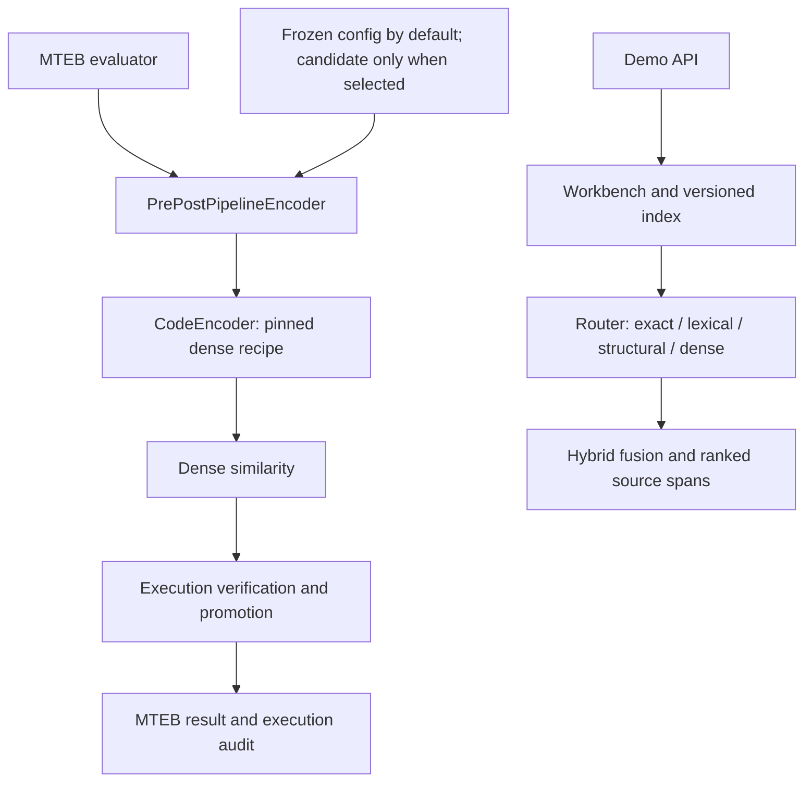

# Architecture and research-state audit

Audited source: `krizz711/CodeDoctor-Agentic-Semantic-and-Structural-Intelligence-for-Code-Repositories`,
branch `v2/prepost-architecture`, commit
`9982be83cb84f11c647b89e0291d5964fc00b0c9` (2026-09-26 checkout).
This is a source/document audit. Existing benchmark numbers below are reported
by the repository, not newly reproduced by this setup.

## Two execution paths

`scripts/evaluate_mteb.py` loads the frozen config by default, constructs the
encoder/pipeline, and adapts `encode()` and `similarity()` for MTEB.
`app/pipeline/encoder.py` records raw texts, computes similarity, optionally
reranks, and applies execution verification. The fitted feature reranker is
currently identity. The execution pass accounts for the claimed scored gain.
The optional document cache avoids re-encoding stored corpus content; queries
are still encoded online. `cache=None` refers to MTEB's result cache, not this
legitimate document-vector cache.

`app/server.py` / `app/workbench.py`, `app/agent/router.py`,
`app/retrieval/hybrid.py` and `app/indexing/` implement the interactive repository
experience. Changes here must not be credited to the screening score without
showing that they reach the scored path.

The explorer's `/api/search` uses a separate SQLite/current-or-pinned-snapshot
path from the workbench's versioned corpus. Workbench verification still loads
the frozen execution settings; candidate flags are not automatically active in
the demo. Structural edges displayed with workbench hits should not be credited
as a separate contribution to the MTEB score.

## Frozen versus candidate

| Setting | Submitted frozen recipe | Candidate v2 at audited commit |
| --- | --- | --- |
| Accuracy encoder | F2LLM-v2-1.7B, pinned revision | Same |
| Initial execution pool | Top 20 | Top 20 |
| Timeout | 2 seconds, wall mode | 2 seconds, CPU mode on POSIX |
| Call-style verification | Off | On |
| Deepening | Off | Up to 50 when triggered |
| Skip interactive statements | Off | On |
| Blank-line fallback | Off | On, C3 E1 |
| Judge-like I/O | Off | On, C3 E1-B |
| Dense-gap gate / hubness | Off | Off |
| Judge rules / extended stdin | Off | Off |

Candidate selection has not replaced the submitted artifact. Preserve both
configs and the existing artifact while setting up Codex.

## Current research state and documentation drift

- `experiments/C3_cycle/E1_result.md` reports blank-line fallback at +0.0078
  NDCG@10 on DEV stdin, +0.0028 across all families, 11 improved / 1 worsened.
  It is candidate-enabled; no screening gain is projected.
- Judge-like I/O is accepted as a fidelity fix with zero DEV ranking changes,
  not a measured quality improvement.
- The latest `C3_cycle/PREREG.md` addendum A3 marks E2 run 1 **VOID** because
  the reference CPU timing failed its sanity bound. It allows one unchanged
  repeat; another void ends E2. The summary's "kernel running" is stale.
- E3 timing is bound to the original i5-11260H laptop by its preregistration.
  Running it on this Mac would require a new machine-specific protocol and
  would not complete that original experiment.
- `experiments/RESULTS.md` contains a 1.7B CPU measurement (7.83 seconds/query,
  8.5 GB) at a specific Kaggle operating point. The README's "not measured"
  statement is older; neither statement establishes performance on this Mac.
- The original V2 plan contains proposals that were later rejected and FAQ
  paraphrases that are stricter than the verbatim jury answers. Use the FAQ in
  `CLAUDE.md`, then the applicable current preregistration/addenda.

## Safeguards and remaining gaps

The branch already tests frozen recipes, candidate flags, MTEB cache disabling,
parallel parity, replay, corpus caching, and platform-specific runner behavior.
CI separates fast tests from model/data tests and MTEB registry checks.

Verified limitations to carry into future plans:

1. `app/evaluation_harness.py`: `get_train_split()` uses a loader that also opens
   test texts/qrels. The guard on `get_test_split()` is an API boundary, not
   sealed file access. Do not invoke data-loading commands under a promise of
   train-only I/O without fixing or isolating that path.
2. `scripts/evaluate_mteb.py`: test access is logged after evaluation; logging
   failures are caught. Authorization and one-run discipline are not enforced
   by this script alone.
3. The candidate runner limits resources; it does not isolate network or
   filesystem access. Do not run arbitrary hostile code on that assumption.
4. Requirements mostly use ranges. A recorded environment snapshot supports
   reproduction but is not a portable dependency lock.
5. Reused EXT-dev and single-edit version mutants do not establish general
   performance on unseen code. Keep their evidential limits in claims.

No product or evaluator changes are needed to install the Codex workflow.
The first research continuation should reconcile E2's permitted repeat with
actual external status, or prepare a fresh Mac-specific P1 timing protocol.
Both begin from the existing preregistration, not the historical architecture
wishlist. Fixing the train-loader boundary is a separate, worthwhile correctness
task before promising enforced train-only experiments.
